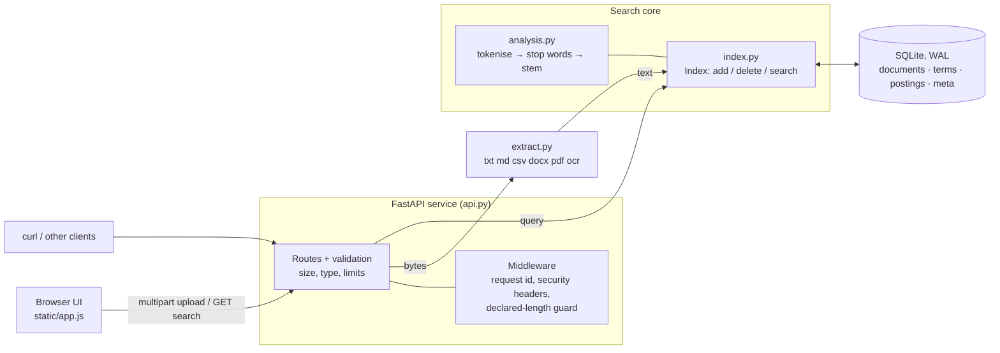
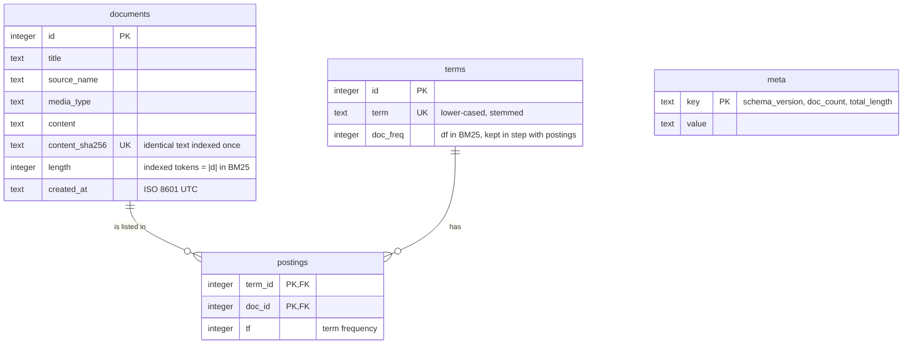

# Architecture

docsearch is a small full-text search engine: it turns uploaded documents into an **inverted index**, ranks matches with **BM25**, and serves both through an HTTP API and a single-page UI. It is one process with one storage file; the interesting part is the index, not the plumbing.

## Components



| Module | Responsibility | Knows about |
|--------|----------------|-------------|
| `analysis.py` | Text → terms. One function used at index time **and** query time | nothing else |
| `extract.py` | Bytes + file name → text, with size/zip-bomb/page limits | nothing else |
| `index.py` | Storage, BM25 scoring, snippets, transactions | `analysis` |
| `api.py` | HTTP, validation, error mapping, headers | all of the above |
| `config.py` | Environment → typed `Settings` | nothing else |

The dependency direction is strictly downward, so `analysis`, `extract` and `index` are unit-testable without HTTP.

## Data model



The full DDL, with comments, is [`src/docsearch/schema.sql`](src/docsearch/schema.sql). `postings` is a `WITHOUT ROWID` table clustered on `(term_id, doc_id)`, so one term's postings list is a single contiguous range scan; the secondary index `postings_by_doc` lets deletion find a document's terms without scanning everything.

The legacy prototype's schema was never committed. From its SQL it was `files(id, file_src, file_text)` and `inverted_index(word_name, word_id JSON)`, with the postings list stored as a JSON array mutated on every token. That has no term frequencies (so no ranking), no document lengths, one commit per token, and rewrites the whole array to add one document.

## Indexing flow

1. `POST /v1/documents` — the middleware rejects a declared `Content-Length` over the limit before reading the body; the route then reads at most `max_upload_bytes + 1` bytes.
2. `extract_text` picks a parser from the (sanitised) extension and returns text, or raises `UnsupportedMediaTypeError` (415) / `ExtractionError` (422).
3. `Index.add` analyses the text into `{term: tf}` and `length`, then in **one `BEGIN IMMEDIATE` transaction**: de-duplicates by SHA-256 of the text, inserts the document, upserts terms, bumps `doc_freq`, inserts postings, updates the corpus counters. Any exception rolls the whole thing back (tested).

Nothing from the upload touches the filesystem, and the original file is not kept: only extracted text and metadata are stored (ADR 0004).

## Query flow and ranking

`Index.search(q, mode, limit, offset)`:

1. Analyse the query with the same function used for documents (so "running" finds "runs").
2. Look up the query terms; in `all` (AND) mode, a term missing from the vocabulary short-circuits to zero results.
3. For each term, read its postings joined with document lengths and accumulate BM25:

```
score(d, q) = Σ over t in q of  idf(t) · tf(t,d)·(k1+1) / ( tf(t,d) + k1·(1 − b + b·|d|/avgdl) )
idf(t)      = ln( 1 + (N − df(t) + 0.5) / (df(t) + 0.5) )          k1 = 1.2, b = 0.75
```

   `N`, `avgdl` come from the `meta` counters (O(1)); `df` from `terms.doc_freq`.
4. AND mode keeps documents that matched every term; the top `offset + limit` are selected with a heap (`O(M log k)` for `M` matching documents), ties broken by document id so results are deterministic.
5. Only the returned page loads document text, to build a **snippet**: the window containing the densest cluster of query-term matches, returned as plain text plus highlight offsets. The server never emits HTML; the UI builds `<mark>` nodes with the DOM API.

The BM25 implementation is verified two ways in `tests/test_index.py`: a hand-computed score for a three-document corpus, and a brute-force reference scorer compared against the index on four queries.

## Concurrency and durability

- SQLite in **WAL** mode: readers do not block the single writer. Writes use `BEGIN IMMEDIATE` with a 30 s busy timeout, so concurrent uploads queue instead of failing (a four-thread test checks that no document is lost).
- Each operation opens its own short-lived connection, which keeps `Index` safe to share across the web server's thread pool. One extra idle connection is held for the index's lifetime, because SQLite checkpoints and deletes the WAL file whenever the *last* connection closes. Profiling showed `close()` taking 7 ms per write; keeping the WAL alive raised indexing from 67 to 219 docs/s on the same corpus (ADR 0005).
- `doc_freq`, `doc_count` and `total_length` are updated in the same transaction as the postings, and a test asserts after mixed adds and deletes that every `doc_freq` equals the real postings count.

## Failure modes

| Failure | Behaviour |
|---------|-----------|
| Unsupported / corrupt / encrypted file | 415 / 422 with a short message, nothing indexed |
| File over limit | 413, either from `Content-Length` before reading or after a bounded read |
| Zip bomb (.docx) | Total uncompressed size checked before parsing |
| Scanned PDF with no text layer | 422 "no indexable text" |
| Crash mid-write | Transaction never committed; WAL recovery on next open |
| Storage unreachable | `/readyz` returns 503; `/healthz` stays 200 (process is alive) |
| Duplicate upload | 200 with the existing document and `duplicate: true` |

## Limits and what would change at scale

This design is honest about its ceiling:

- **One writer, one file.** Fine to roughly a million small documents on one machine; beyond that you shard by document and merge results, or move to a segment-based engine.
- **Query cost grows with postings length.** A query of very common terms scores every posting (see the benchmark's "common terms (OR)" row). Production engines add block-max WAND / early termination and skip lists; the next step here would be to cap or sample postings for terms with very low idf.
- **No phrase or proximity queries.** That needs positions in the postings (and a larger index).
- **English only.** The analyzer is Snowball English; other languages need a per-document language and analyzer choice.
- **Document text is stored in the same database** for snippets. For large corpora, store text in object storage and keep only the index here.
- For real workloads, SQLite FTS5, PostgreSQL full-text search or OpenSearch would be the pragmatic choice — see ADR 0002 for why this project implements the index itself anyway.
