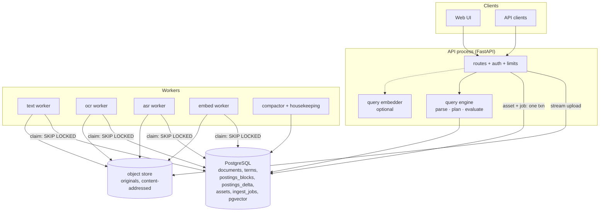
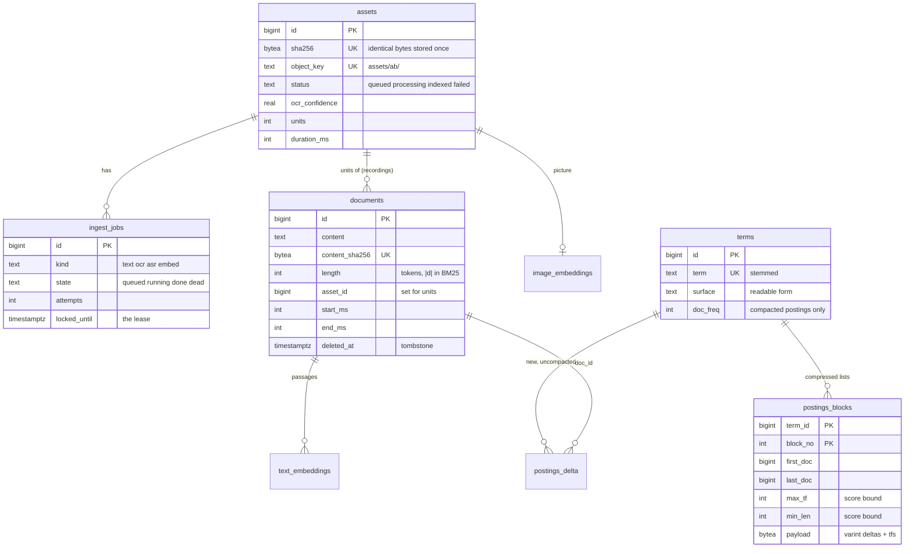
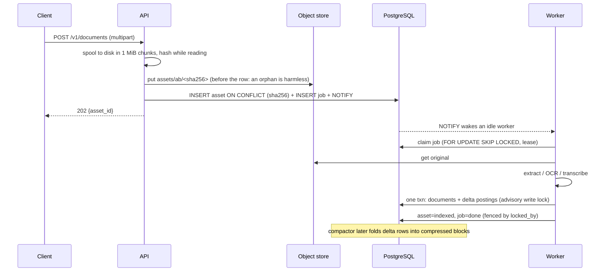

# Architecture

docsearch turns uploads of many kinds into an **inverted index in PostgreSQL** and answers keyword, boolean, phrase and semantic queries. Ingestion is asynchronous and scales by adding worker processes; reads are served from consistent database snapshots. This document describes what exists, why, and where it stops scaling. Each choice has an ADR in [docs/adr](docs/adr).

## Components

The API never extracts text. It stores the file, records an `asset` and a `job` in one transaction, and returns `202`. A worker of the right *kind* claims the job under a lease, extracts text (or transcribes, or embeds), writes documents and postings, and settles the job. Kinds are separate pools because their costs differ by orders of magnitude: a text job takes milliseconds, an OCR page seconds, a minute of speech tens of seconds.

## Data model

DDL, with comments: [src/docsearch/engine/pg_schema.sql](src/docsearch/engine/pg_schema.sql). There are no foreign keys on the posting tables on purpose: they are written in bulk and rebuilt by the compactor.

## Ingestion

Delivery is *at least once*; every step is idempotent (content-addressed keys, `content_sha256` unique, state writes check the lease owner). Permanent errors (corrupt, encrypted, empty) go straight to `dead` with a readable message; transient ones retry with jittered exponential backoff. A scanned PDF starts as a `text` job and is *rerouted* to `ocr` when most pages have no text layer.

**Why a writer lock?** Ingest transactions take a per-schema advisory lock for their short database part (analysis happens before it, in parallel across workers). It makes document ids become visible in order, which lets the compactor append to the tail block instead of rewriting a term, and lets the length cache grow incrementally. It caps write throughput at one transaction at a time; batches amortise it.

## Search

1. **Parse** (`query.py`, total: it never raises on user input), **analyse** with the same analyzer as indexing (script-routed: English or Devanagari stemming).
2. **Plain words** → the top-k engine: per term the compressed blocks are read, then either a *vectorised scan* or *block-max WAND / skip-driven intersection* runs, chosen by a cost rule (prune only if the rarest term is under 5% of documents *and* a scan would touch more than 300,000 postings; AND queries drive from the rarest list). Results equal exhaustive scoring bit for bit (differential tests against the SQLite engine).
3. **Operators** → `engine/boolean.py` evaluates the tree exactly with sorted-array set algebra; phrases are the AND of their words, verified against stored text (capped at 1,000 best candidates, flagged `approximate` beyond that); filters run in SQL on the candidate ids.
4. **Semantic / hybrid** → nearest passages from pgvector, fused with the keyword ranking by reciprocal rank fusion.
5. The whole read runs in one `REPEATABLE READ` read-only transaction, so a compaction or ingest committing mid-query cannot hide or double-count a posting. Deleted documents are excluded by a cached tombstone set.

## Failure modes

| Failure | Effect |
|---|---|
| worker crashes mid-job | lease expires, another worker repeats the job (idempotent); after `max_attempts` the job is dead-lettered and the asset marked failed |
| worker was slow, lost its lease | its late `complete`/`fail` is refused (fencing); the new owner's result stands |
| crash between object write and row insert | an orphaned object; collected by housekeeping after an hour |
| upload deleted while being indexed | the worker notices (its asset update touches no row) and takes its documents back |
| embedding or its job fails | the upload stays keyword-searchable; embed job state never changes asset status |
| object store down | uploads return 503; jobs retry with backoff; `/readyz` reports it |
| database restart | workers log and retry; the API returns 503 on affected routes |
| analyzer changes after indexing | purge can miss postings (space, df drift); tombstones still guarantee deleted documents never appear |
| no worker for a job kind | jobs wait; `docsearch_oldest_waiting_job_seconds{kind}` grows and should be alerted on |

## Scaling

Measured: 300,000 documents on one laptop (README). Reasoned, **not built or measured**:

* **To millions of documents on one node:** the limits seen are query latency for common terms (linear in postings, about 160-230 ms at 300k), the single writer lock, and RAM for the length array (8 bytes per document) and tombstone set. Positions for phrases, a persistent tombstone bitmap and a pooled/partitioned write path are the next steps.
* **To 100M:** shard `documents` and postings by document-id range across PostgreSQL nodes (each shard is a complete index; ids are range-allocated), fan a query out to all shards and merge top-k (BM25 needs global document frequencies, so each shard's `doc_freq`/counts are summed first: a cheap broadcast), keep the object store as is, and move the queue to a broker only if job rates exceed what `SKIP LOCKED` sustains (thousands per second). Read replicas serve search; the compactor runs on primaries. Beyond that, an engine with an FST dictionary and segment merging (Lucene-family) is the honest answer, and the benchmark against Postgres full-text search in the README is the baseline for deciding.

## Testing strategy

| Layer | How |
|---|---|
| Codec, search, query evaluation | property and differential tests: every strategy and mode against the SQLite exhaustive engine and brute-force set algebra |
| PostgreSQL | the same corpora in every storage state (delta, compacted, mixed, after deletion and purge) |
| Queue and pipeline | real database: exclusivity under concurrent claimers, lease expiry, fencing, retry/dead-letter, crash-after-index recovery, parallel workers |
| OCR, speech, embeddings | real Tesseract, Whisper and embedding models inside the worker image, on rendered/synthesised inputs (accuracy claims limited accordingly) |
| UI | component tests (Vitest, Testing Library) and a run against the live stack in a real browser |
| Whole stack | `deploy/smoke.sh` against compose, and the CI `stack` job |

Bugs found by running things rather than reading them are recorded in the ADRs and PROGRESS.md (PyAV 19 breaking faster-whisper, a bucket-creation race between processes, pruning slower than scanning on common terms, database-wide advisory locks, compaction slowing when the delta outgrew cache).
