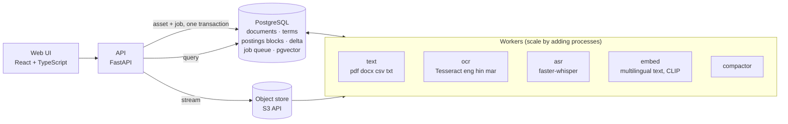

# docsearch

[](https://github.com/dipesh9765/SIH-Big-Data-Searching/actions/workflows/ci.yml)


A search system for **documents, scanned pages, pictures and recordings**, in English, Hindi and Marathi. Upload a PDF, a photo of a page, a lecture video or a spreadsheet; workers extract the text (parsers, Tesseract OCR, Whisper speech-to-text), and an **inverted index of compressed postings blocks in PostgreSQL** answers keyword, phrase, boolean, filtered, typo-tolerant and semantic queries, with a hit in a recording playing from the second it was spoken.

It started as a Smart India Hackathon prototype (Node + EJS + MySQL) whose search never returned a result. This is a ground-up rebuild: the index, ranking, query language, ingestion pipeline and UI are written here and tested against reference implementations. [PROGRESS.md](PROGRESS.md) lists what was verified and, as importantly, what was not.



## What it does

| | |
|---|---|
| **Inputs** | txt, md, csv, docx, pdf (text layer), images (png jpg tiff webp ...), scanned and mixed PDFs, audio (mp3 wav m4a flac ogg ...) and video (mp4 mkv webm mov avi) |
| **Keyword search** | BM25, own inverted index: delta + varint compressed 128-posting blocks with per-block score bounds, block-max WAND and a vectorised scan chosen by a cost rule |
| **Query language** | `"exact phrase"`, `AND` / `OR` / `NOT`, `-term`, `(groups)`, filters `type:` `ext:` `lang:` `before:` `after:` |
| **Forgiving** | autocomplete, typo correction (`pg_trgm` + edit distance), "did you mean" |
| **Hindi / Marathi** | Devanagari-aware tokenisation and stemming (the old tokenizer cut words at every vowel sign), Tesseract `hin`+`mar`, forced-language Whisper |
| **Semantic** (opt-in) | multilingual passage embeddings in pgvector, hybrid ranking by reciprocal rank fusion; a Hindi question retrieves an English passage |
| **Images** (opt-in) | find pictures by describing them (CLIP) |
| **Recordings** | transcribed in 30-60 s units with timestamps; a hit has a "Play from 1:23" button; originals are served with HTTP `Range` |
| **Operations** | asynchronous ingestion (202 + polling), leases, retries with backoff, dead letters, deletion with tombstones, Prometheus `/metrics`, API-key protection, signed media links |

## Quick start

Needs Docker. Everything below runs from the repository root.

```bash
docker compose -f deploy/docker-compose.yml --profile app up -d --build   # api, text worker, OCR worker, Postgres, object store
./deploy/smoke.sh http://127.0.0.1:8080                                   # upload, index, search: "smoke test passed"
```

Open **http://127.0.0.1:8080** for the UI (API docs at `/docs`). Speech-to-text is its own worker: `--profile asr up -d worker-asr`. Semantic and image search: set `DOCSEARCH_SEMANTIC=1` on the API and workers and run an `embed` worker (`--kinds embed`); see [deploy/](deploy/).

Without the UI, from the shell:

```bash
curl -F file=@report.pdf http://127.0.0.1:8080/v1/documents          # 202 {"asset_id": 7, "status": "queued"}
curl http://127.0.0.1:8080/v1/assets/7                                # queued -> processing -> indexed
curl 'http://127.0.0.1:8080/v1/search?q="climate+change"+type:pdf+-coal'
curl 'http://127.0.0.1:8080/v1/suggest?q=glaci'
```

### Development setup

```bash
python -m venv .venv && . .venv/bin/activate        # Windows: .venv\Scripts\activate
pip install -r requirements-dev.txt -r requirements-ocr.txt -e .
docker compose -f deploy/docker-compose.yml up -d postgres objects
make check                                           # ruff, strict mypy, pytest with a 90% coverage gate
cd web && npm ci && npm run lint && npm test && npm run build
```

The OCR, speech and embedding tests need the models, which live in the worker image; they are skipped on a bare machine and run in CI inside the image:
`docker build -f deploy/Dockerfile.worker --target test -t docsearch-worker-test .` then `docker run --rm -v "$PWD:/app" -e DOCSEARCH_TEST_DSN=... docsearch-worker-test pytest -q --no-cov tests`.

The original single-file SQLite mode (`docsearch.api`, no external services) is still in the repository and unchanged; it is the oracle the PostgreSQL engine is tested against.

## API

| | |
|---|---|
| `POST /v1/documents` | store an upload and queue it: 202 with an asset id (200 if these exact bytes were uploaded before; a failed asset is re-queued) |
| `GET /v1/assets/{id}` · `/v1/assets` | status (`queued` `processing` `indexed` `failed`), error, OCR confidence, duration, language |
| `DELETE /v1/assets/{id}` · `/v1/documents/{id}` | leaves search at once; text and original are purged |
| `GET /v1/search` | `q`, `mode=all|any`, `ranking=keyword|semantic|hybrid`, `limit`, `offset`; hits carry `snippet` + highlight offsets (never HTML) and `media` (asset, start/end ms) for recordings |
| `GET /v1/search/images?q=` | pictures by description |
| `GET /v1/suggest?q=` | autocomplete for the last word |
| `GET /v1/assets/{id}/file` · `POST .../file-url` | the original, with `Range`; a signed short-lived URL for `<audio>`/`<video>`/`` |
| `GET /v1/stats` · `/metrics` · `/healthz` · `/readyz` | statistics, Prometheus metrics, probes |

## Configuration

Environment variables (see [deploy/.env.example](deploy/.env.example)); the defaults match the local compose stack and are for development only.

| Variable | Default | |
|---|---|---|
| `DOCSEARCH_DSN`, `DOCSEARCH_SCHEMA` | local Postgres, `public` | database and schema |
| `DOCSEARCH_S3_ENDPOINT` / `_ACCESS_KEY` / `_SECRET_KEY` / `_BUCKET` / `_SECURE` | local object store | any S3-compatible server |
| `DOCSEARCH_API_KEY` | empty (open) | when set, every `/v1` route needs `Authorization: Bearer <key>` |
| `DOCSEARCH_MAX_UPLOAD_MB` · `DOCSEARCH_MAX_MEDIA_MB` | 10 · 500 | documents/images · audio/video |
| `DOCSEARCH_OCR_LANGS` · `DOCSEARCH_OCR_MAX_PAGES` | `eng+hin+mar` · 200 | |
| `DOCSEARCH_ASR_MODEL` · `DOCSEARCH_ASR_LANGUAGE` · `DOCSEARCH_ASR_MAX_MINUTES` | `small` · auto · 240 | set the language (`hi`, `mr`) for Indian-language recordings |
| `DOCSEARCH_SEMANTIC` | off | embeddings, semantic and image search |
| `DOCSEARCH_WEB_DIR` | empty | serve a built UI at `/` |

## How it works

Documents are tokenised, stemmed and written as rows to a small *delta* table in one transaction; a compactor folds them into compressed 128-posting blocks (varint deltas, with the highest term frequency and shortest document length per block, so a score upper bound is known without decoding). Queries run in one `REPEATABLE READ` snapshot, so compaction can never hide or duplicate a posting. Rare terms are searched with block-max WAND; queries of common words use a vectorised scan, because measurement showed pruning loses there. Operators are evaluated exactly with set algebra; phrases are verified against the stored text. Design notes and the data model are in [ARCHITECTURE.md](ARCHITECTURE.md); each decision has an ADR.

## Measured

On a Windows laptop (12 cores, 7.7 GB RAM), PostgreSQL 17 in Docker, **300,000 synthetic documents** (19.5M postings, Zipf-distributed words, ~80 tokens each), top-10, median of 9 runs, against PostgreSQL's built-in full-text search (GIN, `ts_rank_cd`):

| | docsearch | Postgres FTS |
|---|---|---|
| ingest (500-doc batches, includes analysis in Python) | 1,400 docs/s | |
| compaction, run every 50k documents | 125k postings/s | |
| index size without document text | 173 MB | 386 MB |
| rare AND rare | 4.4 ms | 0.7 ms |
| common AND rare | 25.6 ms | 2.3 ms |
| common AND common | 162 ms | 508 ms |
| 3 common words, OR | 231 ms | 2,229 ms |
| common OR rare | 92 ms | 2,003 ms |
| 6-term mixed OR | 67 ms | 3,367 ms |

Full-text search wins selective queries; this index wins queries made of common words, where full-text search must rank every match. Other measurements (in ADRs 0006, 0008, 0011, 0012, 0015): block-max pruning vs scanning, OCR cost per page, Whisper `base` vs `small`, cross-lingual retrieval on a small set. **Not measured:** 1,000,000 documents (this machine has 7.7 GB of RAM), concurrent load, real scans and natural speech, relevance on a real corpus.

## Design decisions

| ADR | Decision |
|---|---|
| [0001](docs/adr/0001-sqlite-storage.md)-[0005](docs/adr/0005-connection-per-operation-with-keepalive.md) | the single-node SQLite engine, own BM25, shared analyzer, text not files |
| [0006](docs/adr/0006-compressed-postings-blocks.md) | compressed postings blocks, block-max WAND, and a cost rule choosing between pruning and scanning |
| [0007](docs/adr/0007-typo-tolerance-and-autocomplete.md) | typo tolerance and autocomplete |
| [0008](docs/adr/0008-postgres-postings-storage.md) | postings in PostgreSQL; why MongoDB was rejected; a rejected experiment (lazy block fetching) with numbers |
| [0009](docs/adr/0009-postgres-job-queue.md) | the job queue in PostgreSQL |
| [0010](docs/adr/0010-object-store-s3-api.md) | content-addressed originals in an S3-compatible store (SeaweedFS, since MinIO's images were withdrawn) |
| [0011](docs/adr/0011-ocr-workers.md) · [0012](docs/adr/0012-speech-to-text.md) | OCR and speech-to-text pools |
| [0013](docs/adr/0013-deletion-tombstones.md) | deletion: tombstone first, purge later |
| [0014](docs/adr/0014-boolean-phrase-filter-queries.md) | query language, phrases by verification |
| [0015](docs/adr/0015-semantic-and-image-search.md) | pgvector, multilingual embeddings, CLIP, rank fusion |

## Limits

Hindi and Marathi speech recognition is weak (see ADR 0012); Marathi has no stemmer of its own; phrase search has no positional index (verified candidates, capped); the API key is a single shared secret and there is no per-user access control, rate limiting or TLS (put it behind a reverse proxy); the tombstone set grows with deletions; embeddings are one job per upload with no bulk backfill command; video is searched through its audio only; only a single PostgreSQL node is implemented (the sharding design is in ARCHITECTURE.md, not built). The CI workflow has not run on GitHub: it was written and checked locally only.

## License

MIT, see [LICENSE](LICENSE).
