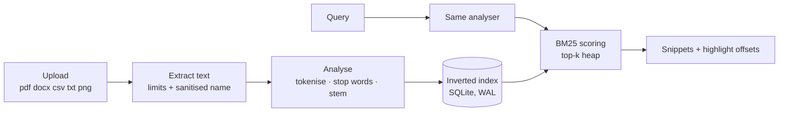

# docsearch

[](https://github.com/dipesh9765/SIH-Big-Data-Searching/actions/workflows/ci.yml)


A small **full-text search engine** you can read in an afternoon. Upload PDF, DOCX, CSV, text or (with OCR) image files; docsearch extracts the text, builds an **inverted index** with corpus statistics, and answers queries with **BM25-ranked** results, highlighted snippets and pagination, through a typed HTTP API and a one-page UI.

It started life as a Smart India Hackathon prototype (Node + EJS + Python subprocesses + MySQL) whose search never actually returned results. This is a ground-up rebuild: one language, one storage file, a documented schema, a ranking model that is tested against a reference implementation, and numbers measured on a reproducible benchmark.



## Quick start

```bash
python -m venv .venv && . .venv/bin/activate        # Windows: .venv\Scripts\activate
pip install -r requirements.txt -e .
uvicorn docsearch.api:create_app --factory          # http://127.0.0.1:8000  (API docs at /docs)
```

Or with Docker (includes Tesseract, so image uploads work):

```bash
docker build -t docsearch . && docker run -p 8000:8000 -v docsearch-data:/data docsearch
```

```bash
curl -F file=@report.pdf http://localhost:8000/v1/documents
curl 'http://localhost:8000/v1/search?q=quarterly+revenue&mode=all&limit=5'
```

Response (illustrative values):

```jsonc
{
  "query": "quarterly revenue", "mode": "all", "total": 1, "took_ms": 1.4,
  "results": [{
    "document": {"id": 3, "title": "report.pdf", "source_name": "report.pdf",
                 "media_type": "application/pdf", "tokens": 1840, "created_at": "2026-10-27T10:15:02+00:00"},
    "score": 7.412,
    "snippet": "… growth in quarterly revenue was driven by …",
    "highlights": [[12, 21], [22, 29]]      // offsets into `snippet`; the server never returns HTML
  }]
}
```

## Scale-out mode (PostgreSQL + object store) — in development

Branch `feature/scale-v2` adds a second deployment mode aimed at millions of documents: an inverted index of compressed postings blocks in PostgreSQL, originals in an S3-compatible store, and asynchronous ingestion by workers. The single-file SQLite mode above is unchanged.

```bash
docker compose -f deploy/docker-compose.yml up -d postgres objects
pip install -r requirements-dev.txt -e .
uvicorn docsearch.service:create_app --factory --port 8080      # the API
python -m docsearch.ingest.worker --compact-interval 20         # one or more workers
curl -F file=@report.pdf http://127.0.0.1:8080/v1/documents     # 202 + asset id
curl http://127.0.0.1:8080/v1/assets/1                          # queued / processing / indexed / failed
curl 'http://127.0.0.1:8080/v1/search?q=glacier'
```

Images and scanned PDFs are read by a separate OCR worker (Tesseract: English, Hindi, Marathi), which runs in Docker:

```bash
docker compose -f deploy/docker-compose.yml --profile ocr up -d --build worker-ocr
curl -F file=@scan.pdf http://127.0.0.1:8080/v1/documents       # a text worker hands it to the OCR pool
```

Measured on 300,000 synthetic documents and what is not yet built: see [PROGRESS.md](PROGRESS.md) and ADRs 0006-0010.

## API

| Method & path | Purpose |
|---------------|---------|
| `POST /v1/documents` | Upload a file (`multipart`, field `file`, optional `?title=`). `201` new, `200` if identical text was already indexed |
| `GET /v1/documents` · `GET /v1/documents/{id}` | List (newest first, paged) / fetch metadata |
| `DELETE /v1/documents/{id}` | Remove a document and its postings |
| `GET /v1/search?q=&mode=all\|any&limit=&offset=` | BM25 search; `all` = every term (AND), `any` = at least one (OR) |
| `GET /v1/stats` | Corpus size, vocabulary, postings, accepted extensions, limits |
| `GET /healthz` · `GET /readyz` | Liveness / readiness (storage check) |

Errors are plain `{"detail": "..."}`: `413` too large, `415` unsupported type, `422` unreadable or empty document / bad parameters, `404` unknown id.

## Configuration

| Variable | Default | Meaning |
|----------|---------|---------|
| `DOCSEARCH_DB` | `data/docsearch.db` | SQLite file (created on first run) |
| `DOCSEARCH_MAX_UPLOAD_MB` | `10` | Per-file upload limit |
| `DOCSEARCH_MAX_RESULTS` | `50` | Cap on `limit` per search |

See `.env.example`. There are no secrets in the code or repository.

## How ranking works

Each query term contributes `idf(t) · tf·(k1+1) / (tf + k1·(1 − b + b·|d|/avgdl))` with `k1 = 1.2`, `b = 0.75`, summed over terms. Document length and corpus statistics are stored and updated transactionally, so a query reads `N` and `avgdl` in O(1). The scorer is checked in `tests/test_index.py` against hand-computed values and against a brute-force reference on a small corpus. Details, the schema/ERD, concurrency model and failure modes are in [ARCHITECTURE.md](ARCHITECTURE.md).

## Measured performance

`python benchmarks/bench.py --docs 5000 --tokens 200` on a seeded Zipf-distributed synthetic corpus (5,000 documents × 200 tokens, 19,971 distinct terms, 701,969 postings, 26.7 MB database), single process, a Windows 11 laptop with an SSD, one transaction per uploaded document:

| Measure | Result |
|---------|--------|
| Indexing throughput | 80 docs/s (≈16k tokens/s) |
| Query: two rare terms (AND) | p50 1.4 ms · p95 1.7 ms · p99 2.1 ms |
| Query: one very common + one rare term (AND) | p50 24 ms · p95 29 ms · p99 33 ms |
| Query: three most common terms (OR) | p50 65 ms · p95 81 ms · p99 90 ms |
| Known-item recall@1 (query = a document's 3 rarest words) | 100% of 200 queries |

Read these honestly: the corpus is synthetic (word frequencies follow Zipf's law, but there is no real semantics), so the recall figure checks ranking sanity and not relevance quality. Latency grows with the length of the query terms' postings lists because every posting is scored; the common-term rows are the worst case (a top word appears in nearly every document). Production engines prune with skip lists and WAND/block-max; see "Limits" in ARCHITECTURE.md. The benchmark found and fixed one real cost: SQLite's WAL teardown on every connection close (ADR 0005), worth 3.3× indexing throughput at the time.

## Development

```bash
pip install -r requirements-dev.txt -e .
make check     # ruff + strict mypy + pytest with a 90% coverage gate
make bench
```

82 tests (one needs the real Tesseract binary and runs in CI) cover the analyzer, BM25 maths, index consistency after mixed adds/deletes, rollback on failure, concurrent writers, every extractor (including corrupt, encrypted and zip-bomb inputs), the HTTP API (limits, status codes, injection-like input, security headers) and configuration. CI runs lint, types and tests on Python 3.12 and 3.13, a benchmark smoke test, and builds and smoke-tests the Docker image.

## Design decisions

| ADR | Decision |
|-----|----------|
| [0001](docs/adr/0001-sqlite-storage.md) | SQLite in WAL mode instead of a database server |
| [0002](docs/adr/0002-own-bm25-index.md) | Implement the index and BM25 directly rather than calling SQLite FTS5 (and why you would not in production) |
| [0003](docs/adr/0003-shared-analyzer.md) | One analyzer for documents and queries |
| [0004](docs/adr/0004-store-text-not-files.md) | Keep extracted text, not the uploaded file |
| [0005](docs/adr/0005-connection-per-operation-with-keepalive.md) | Connection per operation plus a keep-alive connection (measured) |

## Limits and roadmap

No phrase/proximity queries (needs positions in postings), English-only analysis, single writer, no authentication or rate limiting (see [SECURITY.md](SECURITY.md)), and no bulk-ingest endpoint (each upload is its own transaction). Next steps in order of value: bulk ingest in one transaction, postings pruning for very common terms, positional postings for phrase queries, and per-document language detection.

## Project history

The original prototype's code is in the git history before the `chore: remove the Node/EJS prototype` commit. Its audit — including why search never returned a result — is in [PROGRESS.md](PROGRESS.md).

## License

MIT, see [LICENSE](LICENSE).
